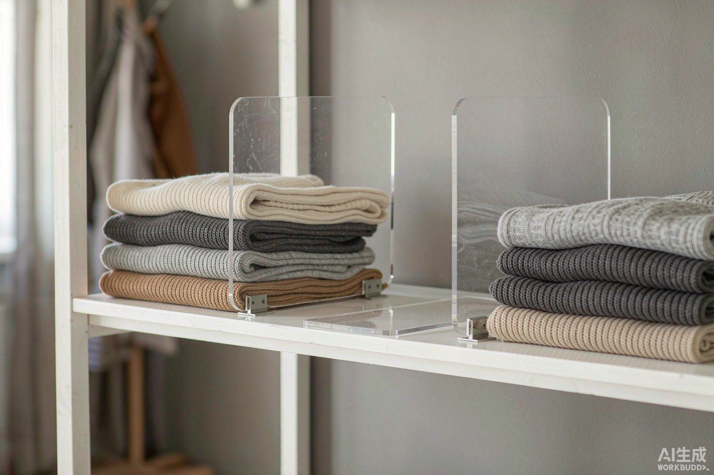

Every folded sweater stack in my closet used to live on borrowed time. It would stand neatly for a day, then the weight of a chunky wool sweater on top would send the whole column sliding sideways into its neighbor. Pull one sweater from the middle and the stack falls like dominoes. By the end of the week the shelf was a landscape of collapsed towers and I was re-folding clothes that had never been worn.

The fix cost me under $25. Closet shelf dividers for folded sweaters are exactly what they sound like: rigid panels that clamp or slide onto an existing shelf and split one long runway into a row of fixed slots. Slots can't lean. That single constraint changed how my folded storage works.

## Why sweater stacks fail in the first place

It's physics, not sloppiness. A stack of five sweaters is a tall, soft, flexible column resting on a smooth surface. Three things work against it:

- Weight gradient. The heaviest knits naturally end up on top (you grab the bottom one less often), so the stack is top-heavy and tips easily.
- No lateral support. A stack surrounded by empty shelf space has nothing to lean on until it hits the next stack, and then they lean on each other like a line of falling books.
- Pull-from-the-middle. You want the third sweater down, so you slide it out and the two above it settle, shift, and eventually slump.

Folding tighter helps. Stacking lighter-on-top helps more. But neither fixes the root problem: a stack with no side walls is always one careless reach away from falling over. Dividers give it those walls.

## What shelf dividers actually do

A divider is a vertical panel, usually 8 to 12 inches tall and 10 to 14 inches deep, fixed perpendicular to the shelf front. Slide-on acrylic versions hook over the front edge; screw-in and clamp versions attach more permanently; wire-shelf versions snap onto the front and back wires of a wire shelf.

Once installed, each slot becomes a self-contained cubby:

1. Stacks can't migrate. The divider walls stop the slow sideways creep that turns neat columns into a jumble.
2. You pull with one hand. Grab the middle sweater and the neighbors above it stay put, because the divider, not the adjacent stack, absorbs the lean.
3. Every stack edge stays visible. This is the quiet benefit. When slots are fixed. You can scan the shelf like a filing cabinet, which is the same principle behind filing sweaters vertically in [my full vertical closet system](/blog/vertical-closet-system-maximize-small-wardrobe/).

## Types compared: what to buy

I've used three kinds across two closets. Here's the honest breakdown:

| Type | Typical cost (4-pack) | Best for | Watch out for |
|---|---|---|---|
| Clear acrylic, slide-on | $12▶0 | Flat wood/laminate shelves; showing off neat stacks | Can crack if flexed hard during install; needs a straight shelf edge |
| Metal wire, slide-on | $8▶5 | Budget setups; heavier stacks | Coils can snag loose knits; add a liner for wool and cashmere |
| Wire-shelf snap-on | $10▶8 | Builder-grade wire closet shelves | Must match your shelf's wire spacing; check before buying |
| Screw-in / clamp wood | $15▶0 | Rental-proof permanence; very heavy knits | Overkill for most people; requires drilling |

For sweaters specifically, I land on clear acrylic. Sweaters are exactly the category where snagging matters most, and the see-through panels mean you spot the gray sweater's edge instantly instead of pulling stacks to hunt. The premium over wire is a few dollars per shelf.

## Sizing: measure before you order

This is the step people skip, and it's why some buyers end up with dividers that float loosely or don't fit at all. Two measurements matter:

Shelf depth. Standard closet shelves are 12 to 16 inches deep. Your divider should be close to the shelf depth, because a 10-inch divider on a 16-inch shelf leaves 6 inches of unsupported shelf behind every stack, which is where the leaning starts. When in doubt, size up.

Divider height versus stack height. The divider only supports the stack if it's about as tall as the stack itself. Fold a typical sweater of yours and measure: most come out 6 to 8 inches tall folded. Dividers in the 8▶2 inch range handle that with margin. Taller dividers (14+) exist for linen closets and towels, but on a sweater shelf they block light and make the top shelf feel like a cage.

One more number worth knowing: a 4-foot shelf divided into 10-inch slots gives you four to five slots per section. Four to six folded sweaters fit per slot, so one divided 4-foot shelf realistically holds 30 to 40 sweaters, more than the leaning-tower method, because nothing is wasted on lean-over territory.

## How I set mine up (10 minutes)

1. Empty the shelf and fold everything using a compact rectangle fold, roughly the same width as your hand span. This is the fold-from-the-vertical-closet method; it matters here too, because skinny folds fit slots better than wide flat folds.
2. Mark slot positions with the divider's actual footprint: hold one up as a spacer rather than measuring with a tape. Consistency matters more than precision.
3. Slide dividers on, front edge first, then back. Acrylic flexes just enough to hook over; don't force it or it'll crack at the seam.
4. Refill heavy items at the bottom of each stack. Chunky wool and cable knits go in first, lighter merino and cashmere on top. Now the weight gradient works for you instead of against you.
5. Keep stacks at or below divider height. If a stack pokes above the wall. It can still tip, so either split it into two slots or move a piece to the donation pile.

## Two mistakes I made so you don't have to

I bought dividers before measuring stack height. My first set was 6 inches tall, shorter than my folded chunky knits, so the tall stacks still leaned right over the top of the "walls." Useless. Fold first, measure second, buy third.

I overloaded slots anyway. Eight sweaters in one slot compresses the bottom two into a wrinkled brick and makes the whole stack taller than the divider. Four to six is the honest ceiling. If everything doesn't fit. that's a volume problem, not a divider problem, because dividers just make the truth visible. And if the volume problem is happening because you're mid-move, the honest fix is upstream: the [declutter-before-moving checklist](/blog/how-to-declutter-before-moving-checklist/) clears the donation pile before it ever reaches a shelf.

## The payoff

Closet shelf dividers for folded sweaters are one of the few organization purchases where the cheap version and the expensive version do the same job. For under $25, clear acrylic dividers on one shelf eliminated the daily re-fold cycle, cut my getting-dressed time because I could actually see my options, and made the shelf look deliberately organized instead of accidentally collapsed. Measure your shelf depth and your folded stack height first, because those two numbers decide everything else.
