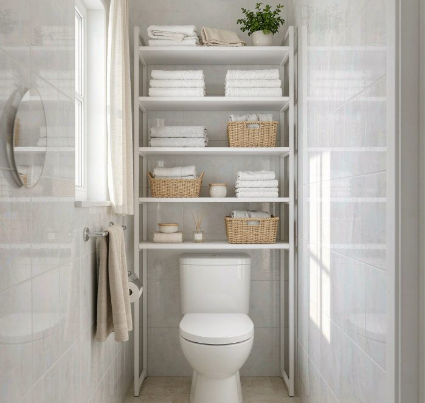

You can get under your bathroom sink organized in one sitting, about 40 minutes, and keep it that way with a five-minute check each month. This is the exact order I use, now tested across three apartments and two different plumbing setups.

Don't just start shoving bottles around. The order matters; everything before step three is prep, and skipping the measuring step is why most people end up with bins that don't fit. If you want the two-year materials comparison behind my choices. that's a [separate post](/blog/under-sink-storage-plumbing-friendly/). This one is just the process.

The order, roughly

1. Empty it. Pull everything out, including the thing that rolled to the back in 2022.
2. Clean and lay a mat. Wipe it down, then an absorbent mat on the floor.
3. Map the P-trap. Measure and trace it before buying anything.
4. Sort and cut. Pull duplicates, expire meds, relocate strays.
5. Zone. Daily stuff in front, backups in back, nothing in front of the trap.
6. Label and set a monthly reminder.

First run is 40�?0 minutes. If you're redoing an already-organized cabinet after a busy season, about 15.

Step 1: empty it completely (10 min)

Every item, out. Set up three piles on the floor or counter before you start: keep-here (used weekly or more), relocate (belongs in another room. That hair dryer doesn't live here), and trash (expired, leaking, dried out). You're not deciding yet; you're just getting eyes on the full inventory so nothing hides.

Step 2: clean, then the mat (5 min)

Wipe the cabinet floor and walls with a mild cleaner. Check for old water rings while you're in there. If the wood is swollen or soft, fix the leak first, not the organization.

Then lay an absorbent mat across the floor. Cheapest insurance in the whole system: a leak shows up as a wet patch on the mat instead of quietly rotting the cabinet base. Mine was about $6 and needs replacing every six months.

Step 3: map before you buy (10 min)

The step people skip, and the reason their bins end up in a donation pile a month later.

Trace the P-trap's footprint on the floor with a marker or painter's tape. It's never centered. It bulges to one side. Once you see its actual shape, most of your usable space is above the trap, not beside it.

Four numbers while you're down there: cabinet width, depth (door to back wall), height (floor to underside of the counter), and clearance above the trap's highest point. Write them in your phone. Every bin purchase from now on gets checked against those numbers, not against your memory of "it seemed about right."

Step 4: sort and cut (10 min)

Pile by pile:
- Bin the expired. Three-summers-ago sunscreen. That old prescription, the half-solid moisturizer, gone. Meds have real expiry dates; check them.
- Merge duplicates. You probably have three half-used tubes of the same hand cream. One gets consolidated, keep the unopened backup, recycle the rest.
- Relocate the strays. Kitchen cleaning sprays, tools, candles. Each goes to its actual home. Under-sink is prime real estate; it only earns it holding bathroom things.

A healthy target: this step usually cuts my starting pile by a third before any bin enters the picture. Decluttering first is what makes organizing last; bins around clutter just make tidier clutter.

Step 5: assign zones (10 min)

With the trap traced and the pile cut, give each item a zone by how often you touch it:
- Left/front: daily items (face wash, toothpaste backup, floss) in a pull-out basket near the door.
- Right: weekly items (hair products, body lotion) in a medium basket.
- Back wall: backups and refills. You touch these monthly, so distance is fine.
- Above the trap: a shallow shelf or small bin, light items only (cotton pads, small towels).
- On the trap: nothing. Ever.

Two rules keep it alive: daily items never go in the back (if you reach past something every morning, the system is already dying), and nothing sits in front of the trap (when a leak or clog happens you need access without unloading six containers). I keep daily items in a pull-out basket with a few holes drilled near the top for airflow. Closed bins in this humid spot go musty. The ventilation reasoning is in the materials post.

Step 6: label and schedule (5 min)

Label every bin, even the obvious ones. You'll forget what's in the back container by February; everyone does. A strip of masking tape and a marker is fine, don't let label aesthetics delay finishing.

Then set a repeating monthly reminder: "under-sink 5-minute check." In those five minutes: glance at the mat (dry?), toss anything expired you spot, push items back into their zones. That's the whole routine.

The month it fell apart

Month four at my last apartment, a houseguest stayed two weeks. Extra towels, guest toiletries, a second hair tool, all shoved "temporarily" into the cabinet. No zones, no labels, just in. After they left I kept opening it, seeing the pile, closing it. That went on about three weeks.

What fixed it: I ran only steps 1 and 4 (empty, sort, cut) without redoing the whole method. Twenty minutes. The zones were still in my head, so once the pile was cut, everything dropped back into place.

The system bends; it doesn't have to break. When it collapses, and a busy week will, just re-run the first two steps, not the entire sequence. That reframe is the only reason I've kept this going for years instead of reorganizing from scratch every spring like I used to.

What to buy, and what to skip

Total for my current setup: about $35.
- 2 clear pull-out baskets, $12�?6 each
- 1 shallow lidded bin for backups, $8
- 1 absorbent mat, $5�?
- masking tape + marker for labels, already owned

Skip: multi-tier sliding drawer units (unless your clearance number says otherwise (they rarely fit above the trap), bamboo anything in this humidity, and any bin you buy before measuring. Good news) this is one of the cheapest organizing projects in the house. The hardware matters far less than the order you do it in.

Before your first run

Quick checklist: 40 minutes blocked off, a trash bag ready, mild cleaner and a rag, your phone's measuring app or a tape measure, and a repeating monthly reminder to set at the end.

Once this cabinet's done, the same zone logic works everywhere, one shelf at a time. My [over-the-toilet breakdown](/blog/over-the-toilet-storage-ideas/) covers the space directly above it, and if the wardrobe's the real bottleneck, the same measure-first habit is in my [vertical closet post](/blog/vertical-closet-system-maximize-small-wardrobe/). The other end of the same logic is the counter: whatever earns a spot in the open gets picked by usage rate, not by how it looks, which is the whole premise of my [bathroom counter budget](/blog/bathroom-counter-clutter-solutions/).

I'm tracking how long the labels survive on the baskets, my bet is the tape yellows before it peels. I'll report back either way. And the trap this post keeps working around is the same reason some vanities ship drawers with a U-cutout and others ship short ones; the [small vanity guide](/blog/small-bathroom-vanity-with-built-in-storage/) puts numbers on that block of pipe-owned space, and the [hidden storage ladder](/blog/hidden-storage-solutions-for-bathroom-vanity/) extends the same cabinet downward, into the toe-kick and the door backs.
