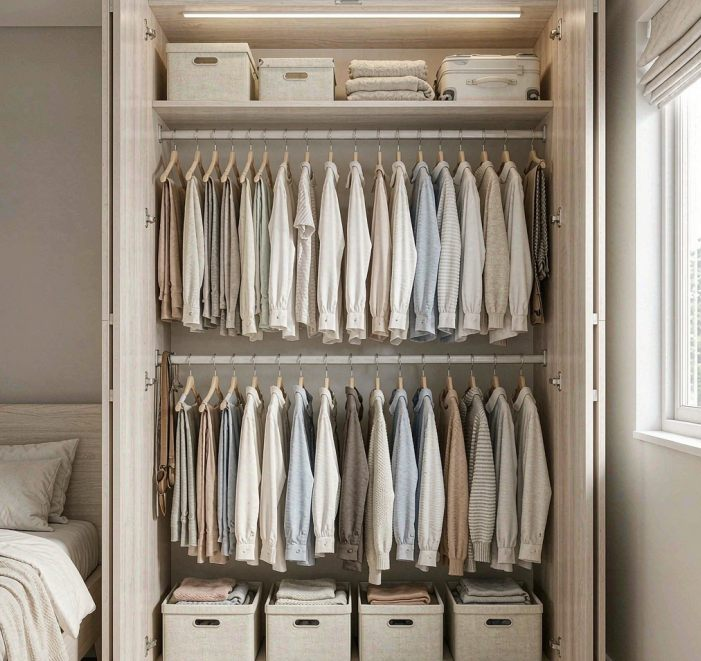

My vanity counter held 23 things in October. It holds three now. The whole thing cost about $115 in trays, dividers, and pump bottles, the vanity stayed, the countertop stayed, nothing got renovated.

The look people call a "minimalist bathroom" is mostly a storage problem in disguise. You don't need a new vanity or a stone top. You need every product to have a home that isn't the counter. Here's what actually changed.

Before: what was really on there

I counted before touching anything:
- Two toothbrushes in a free cup, plus a third with no cup
- Three toothpaste tubes (two nearly empty)
- A skincare tower: cleanser, toner, serum, moisturizer, eye cream
- Two sunscreens, one expired
- A soap dispenser, a second dispenser, a hand cream
- Deodorant, a razor, shaving cream
- A hairbrush, a comb, contact-lens cases and solution
- A candle, a plant, a jewelry dish with no jewelry

Twenty-three items. Every one "used often enough to leave out." None had a drawer. The single drawer below held a hair-dryer cord, old receipts, and nothing useful.

The worst part wasn't the look. It was cleaning. Wiping that counter meant moving eleven bottles, twice a week.

What I changed

Cleared the counter completely. Everything into a shoebox on the bed. Empty counter, wiped down, five minutes.

Sorted by honest use. One question per item: every day, or not? Twenty failed. They didn't get thrown out. They got moved. The daily few: toothbrushes, toothpaste, face wash, deodorant, soap.

Gave the drawer a job. $18 in bamboo dividers turned the junk drawer into three zones: dental, skincare, hair. The skincare tower now stands in one row in the middle zone so I see every bottle at once.

Corralled the keepers in one tray. A lidded tray ($14) holds the three daily items I want at arm's reach but not on display. Lid closed, counter looks empty. Lid open. everything's right there. This one object did more for the clean look than anything else.

Decanted what shows. Pump bottles ($11 for a pair) for hand soap and lotion. Uniform pumps kill the label noise. That alone reads as "minimalist" from the door. Originals stay under the sink for refills.

Gave hair tools a heat-safe home. A silicone-lined bin ($9) in the cabinet under the vanity. Flat iron goes in warm, cord wrapped. No more cord nest on the counter.

Cut decorations to one. The candle stayed. The plant moved to the windowsill where it stopped leaving dust rings on the counter. One object, one story.

Total: $18 + $14 + $11 + $9, plus a drawer organizer I already had. Call it $115 with the hand towel.

After: what's on there now

Three things:
- One soap pump by the sink
- One lidded tray, closed, holding the daily items
- One hand towel on a ring beside the vanity

Toothbrushes live in the tray now, not in a cup on display. The counter wipes in ten seconds because nothing moves first. Guests assume I tidied for them. I didn't. that's just where things live.

What I skipped, and why

A new vanity. The internet says the clean look needs a floating vanity with integrated storage. Mine's a builder-grade box from 2015. With the counter clear, nobody can tell. $800-plus saved.

Countertop organizer sets. The matching acrylic sets are pretty and solve nothing. They organize products that shouldn't be on the counter in the first place.

A medicine-cabinet mirror upgrade. Tempting, unnecessary. Storage behind the mirror is nice; the drawers below already held everything.

A label printer. Masking tape on the inside of drawer zones. Invisible closed, obvious open, free.

Three months later

The look survived, with two caveats. The lidded tray leaves water rings underneath (wipe under it weekly or the counter shows faint marks. I learned that at week five and keep a folded cloth in the cabinet for it. And the nightly reset matters: two minutes before bed. Everything back in its zone, lid closed. Miss three nights running) like the week I had a deadline, and the counter creeps back toward a dozen items. It recovers in one reset. That's the difference between a system and a binge.

One honest failure: the "one row, see every bottle" skincare zone didn't last. Ten bottles don't fit one row in a shallow drawer. Six do; the other four live in a second-row bin. Fine.

If you want the same look

The rules that actually produced it:
1. Nothing on the counter without daily use. Weekly goes in drawers; monthly goes under the sink.
2. One tray, maximum. A lidded tray is the entire secret to an "empty counter" with real life happening on it.
3. Decant what shows. Matching pumps for anything visible. Labels are the noise; remove them, remove the noise.
4. Every product needs an off-counter home before it enters the bathroom. No home, no entry.
5. Two-minute nightly reset. Cheaper than a bigger vanity.

If the vanity drawers are full before you start, clear those first with the same method I use under the sink, my [step-by-step under-sink process](/blog/how-to-organize-under-bathroom-sink/) works one shelf over. And if the bathroom's small enough that the toilet area does storage duty too, my [over-the-toilet storage test](/blog/over-the-toilet-storage-ideas/) covers the only other vertical surface in the room.

I'm watching whether the cheap pump seals hold past six months. They sometimes weep at the neck. I'll report back with what survived.
