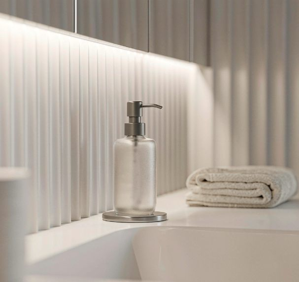

The space over the toilet is the best storage you've got in a small bathroom, and almost everyone wastes it. I ran four different setups through my 40-square-foot bathroom over roughly two years, spending somewhere between $18 and $110, and ended up on the cheapest option: a freestanding etagere plus one small wall shelf.

Short version up front: the freestanding unit won because it needs no drilling, holds the most, and never tipped in two years. The tension-pole caddy was the disappointment, rusted and wobbled within months. The rest is detail.

Why this spot is worth the trouble

My bathroom is small enough that the door nearly clips the vanity. When I moved in, the only storage was a tiny under-sink cabinet (I wrote about [making that work around the plumbing](/blog/under-sink-storage-plumbing-friendly/) separately). Towels, backup toilet paper, cleaning supplies, all lived in a plastic bin in the hall closet. Which meant, dripping and halfway through a shower, I'd walk out to grab a towel. Do that a couple of times and you start caring about vertical space.

The toilet alcove turned out to be the answer. Mine is 30 inches wide, wall to wall, with about 32 inches of usable height above the tank. Roughly six square feet of storage doing nothing but collecting dust.

It has three problems that normal shelving advice skips. The tank and flush button decide how low your lowest shelf can sit. Shower humidity attacks anything metal or paper. And whatever you put up there gets looked at every single time someone uses the bathroom, so it can't read as chaos.

The four setups, and what they actually cost me

I didn't buy these all at once. This was two years of replacing what didn't work.

| Type | What I paid | How it held up | The real issue |
|---|---|---|---|
| Freestanding etagere | $45 | 2 years, no issues | Needs rubber feet or it rocks on tile |
| Wall shelf (above tank) | $18 | 2 years, solid | Requires drilling, not every lease allows it |
| Tension-pole caddy | $22 | Rusted at the joints in 4 months | Wobbles the moment you touch a shelf |
| Cabinet with doors | $95, returned | Sent back after a week | Too deep for my alcove, tank stuck out past the frame |

The table hides the interesting parts, so here's what actually happened.

The freestanding etagere is the one I kept. Three open glass-and-metal shelves on four legs that just stand behind and above the tank. Open means humidity doesn't get trapped; nothing attaches to the wall means my deposit is safe. I stuck rubber feet on after the first week because it rocked a little on the grout lines. Five dollars, and it's the difference between "annoying" and "forget it's there."

The wall shelf solved a different problem. The etagere's lowest shelf sits above the tank, too high for a kid-height guest to reach a towel. One 24-inch shelf on the side wall holds hand towels and the tissues guests actually use. I hit a stud and used two anchors. Two years, no sag.

The tension-pole caddy is the one I'd steer you away from, especially the cheap ones. Mine was a floor-to-ceiling pole with four plastic baskets. In theory, perfect for renters. In practice, the spring tension loosened over about six weeks, the pole leaned, and the chrome started flaking where shower steam condensed every day. By month four a basket wouldn't stay level with a full shampoo bottle on it. Maybe the $60-plus versions are built better; I can't speak to those. The $22 one is in a donation box.

The cabinet with doors was my most expensive mistake, and purely a measuring failure. I ordered it because closed storage photographs tidier. It arrived, I built it, and the tank stuck out about an inch past the frame, doors wouldn't close, because I'd never checked the depth from the wall to the tank's widest point. Back in the box that same week. The lesson's below so you don't repeat it.

Measure these five things before you buy

This is the reason I wrote the post. Ten minutes with a tape measure:

1. Alcove width, wall to wall, at the height where the widest part of the unit will sit. My 30-inch alcove fits a 25-inch unit with room to spare.
2. Tank top to ceiling, your usable height. Mine is 32; the etagere's shelf height is 30, leaving an air gap so the room doesn't feel boxed in.
3. Tank top height off the floor, mine is 30 inches. Anything stored below that line is unreachable over the tank, so the lowest shelf has to clear it.
4. Wall to the tank's widest point, the depth check that killed my cabinet. Push-button and lever tanks vary a lot here.
5. Lid clearance, the lid lifts off for cleaning and flapper repairs. Leave a hand's width above it.

Write the five numbers in your phone before you shop. Every listing gives width × depth × height, and five minutes of comparing beats a week of re-boxing a $95 cabinet.

What to put up there, and what to keep off

Humidity decides it. My shower is six feet from the toilet, so those shelves live in a steam zone.

Up top works: rolled spare towels (lower shelf, not the top), toilet paper in a sealed bin or on the top shelf away from direct steam, cleaning supplies in their original bottles, a small lidded basket for hair ties and flossers, and real-but-decorative things like a candle or a pothos (it doesn't mind the humidity).

Off it: open toilet paper at tank level (the bottom rolls went damp within weeks, sealed bin or top shelf only), anything electronic, cardboard, and medication. Most meds say store below 77°F/25°C in a dry place. A steamy bathroom is neither.

One rule I learned by dropping things: the top shelf gets the light stuff. I had a glass jar of cotton rounds up there, knocked it reaching for a towel, and spent ten minutes picking glass out of the grout. Light high, heavy below waist level.

If you rent: the no-drill options that held up

I've rented most of the last decade, so the deposit matters. Ranked by how they actually did:

- Freestanding etagere with rubber feet, the winner. No wall contact, no damage, and if it ever did tip (mine hasn't, and I anchored nothing) it falls into open floor, not onto the tank.
- Over-the-tank tray, a small caddy that hooks over the tank itself. Fine for a hand towel and a candle, useless for real storage, but it's $15 and takes thirty seconds.
- Adhesive strips holding a light shelf, I tried this with a 20-inch floating shelf. It held two towels for about five months, then let go at 2 a.m. Towels were fine; the shelf corner chipped. I don't trust adhesive strips with anything above ankle height.
- Tension-pole caddy, see above. Rented walls deserve better.

If your lease allows a couple of small anchored holes (many do, with a patch-and-paint clause) one properly anchored shelf beats every no-drill option. Ask the landlord. Cheaper conversation than a fallen shelf.

Mistakes, so you don't repeat them

- Bought before measuring depth. The $95 cabinet. Now I measure first, always.
- Cheaped out on the metal. The tension pole's flaking chrome taught me that in a steam zone, powder-coated or stainless is worth the extra ten or fifteen dollars.
- Watered a plant over the tank. Drips down the tank's back seam, and hard-water marks on porcelain are nearly impossible to scrub off. The plant moved to the windowsill; a fake one holds the shelf spot.
- Ignored lid clearance. The first etagere I ordered had a bottom shelf 27 inches high, under my 30-inch tank top. Nothing fit. Check that measurement twice.
- Overloaded the top shelf. See: cotton rounds, glass jar, grout. Physics wins.

What I'd do again

If I set this bathroom up tomorrow, same freestanding etagere, same one stud-mounted shelf, about $65 total, and I'd skip the tension pole and the closed cabinet entirely. Measure the alcove, the tank, and the lid clearance first. it's the difference between a one-trip install and a return-shipping week.

The system runs itself now: towels and guest stuff within reach, backups in the sealed bin on top. Nothing heavy above shoulder height. With the under-sink setup, the whole bathroom stores what it needs in about eight square feet of cabinetry and shelving.

If you're working through a small bathroom, the under-sink guide above pairs with this one, and if the real bottleneck is the closet, my [vertical closet system for a small wardrobe](/blog/vertical-closet-system-maximize-small-wardrobe/) uses the same measure-first habit one room over. I'm still tracking whether the sealed toilet-paper bin actually keeps rolls dry through a full humid summer; I'll update this when I know. One thing I did rule out: with the floor this tight, a [rolling cart](/blog/rolling-cart-organization-for-small-bathroom/) would have sat inside the door arc, so the vertical space above the tank was the only honest option.
