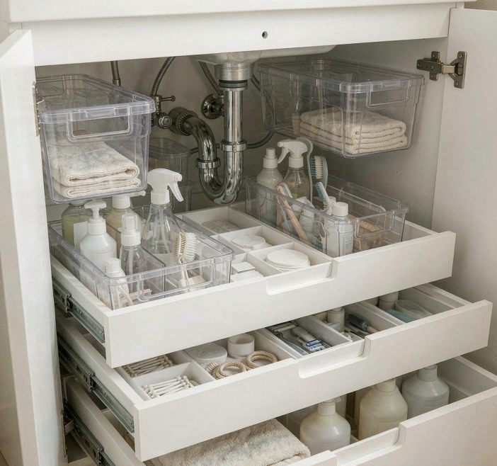

> **Note**: This guide is written for North American plumbing with P-traps. If you're elsewhere, your under-sink layout may differ. Adapt to your local setup.

When I moved in I was excited about the under-sink space. Two doors, looked roomy. I figured I'd drop my cleaning supplies and extra stuff down there and call it done.

It's not that simple.

Nobody talks about under-sink organization much, because it's a mess to think about. You've got the P-trap eating space, moisture building up constantly, and weird heat pockets off the hot-water pipes. Normal organizing advice falls apart here. Most bins don't fit, cardboard swells, and if you're careless with chemicals you've got a hazard.

I spent about four months on different approaches (including one leak that cost me $200 in repairs) before I figured out what actually works.

Why the standard advice fails here

The P-trap is the first surprise. In a 24-inch cabinet it doesn't just take up room. It owns the back wall. Mine measures about 8 inches deep. I started with shallow drawers, thinking they'd slide right in. They wouldn't close. First week was me pulling them in and out, frustrated.

Then moisture. Not theoretical. I once put cleaning supplies in cardboard boxes under the kitchen sink, figured a month was fine. Two months later everything was warped and a couple of bottles had leaked inside the box. Damage already done.

The real wake-up call was chemistry. I bought an airtight container, feeling clever, sealed everything up. Put a leaking ammonia bottle in there one night and went to sleep. Next morning I nearly passed out opening the cabinet. Fumes had built up with nowhere to go. Sealing things airtight under a sink is flat-out dangerous, not clever.

What I actually settled on

After trying five setups over a couple of months, I landed on something unglamorous but functional. (If you want the step-by-step process (empty, map the pipes, zone, label) that's [a separate post](/blog/how-to-organize-under-bathroom-sink/). This one's about what materials survive down there.)

First I stopped guessing and measured. My bathroom under-sink is 30 inches wide, 18 deep, 20 tall. Clearance above the P-trap is only 8 inches. Which sounds useless until you realize that's where most of your storage actually goes. The kitchen cabinet's different: 36 wide, 15 deep, 24 tall, 6 inches of clearance. Here's what organizers won't tell you: the P-trap isn't symmetrical. It sticks out more on one side. I drew its shape on the floor with a marker. Seeing the actual obstacle made everything else obvious.

What to store things in

Clear plastic bins are the answer. I tried metal, bamboo, wood, fancy containers, clear plastic wins. Cheap, lasts, and you can see what's inside without opening it. The same transparency logic, run at full scale, is what makes [aesthetic fridge organization](/blog/aesthetic-fridge-organization-tips/) actually reduce food waste instead of just looking good. Here's the scorecard after six months:

| Container | Cost | Verdict |
|---|---|---|
| Clear plastic bins (unlidded) | $4▶ | The workhorse. See-through, cheap. They do pick up odors after about six months |
| Ventilated pull-out baskets | $12▶0 | The key piece. I can reach the back without dislocating a shoulder. Must be ventilated; I drill holes |
| Metal shelving | $25▶0 | Solid, except water pools in the corners |
| Bamboo or wood | $15▶5 | Avoid. Swells, warps, grows mold |
| Stainless | $20▶0 | Fine, but overkill unless you just hate money |

My setup is clear bins plus ventilated pull-out baskets. I drilled holes in the baskets immediately. Six at first, then eight after the first month when I noticed a stale smell.

How I arranged it

The top shelf is light stuff only: extra hand soap, rolled towels, first-aid. Nothing heavy.

The middle is the pull-out zone, and it's the money move. Left basket: cleaning sprays (drilled). Right basket: makeup and haircare. Both slide out fully, so I reach the very back without the half-squat-half-contortion thing.

The bottom is where the P-trap lives, so I store almost nothing directly in front of it. Left side stays clear for maintenance. Right side holds a small clear bin of backups. The point is flexibility. If something leaks or backs up, I need that space without moving six containers.

And the absorbent mat on the floor. Boring, but it's the leak early-warning system. A small leak shows up immediately instead of me finding water damage three months later.

What goes down there, and what doesn't

Never: glass (shatters the second the door swings hard), sealed plastic bottles (pressure builds. They leak. Learned that the hard way), paper, or dry goods in boxes. Humidity wrecks them.

Lives down there fine: spray bottles with ventilation holes, bar soap, pump dispensers for haircare, metal containers with dry goods, rolled towels and cloths.

One thing I learned by burning myself: the hot-water pipe gets hot. I touched one once and regretted it. Anything flammable or chemical stays at least three inches from those pipes. Not a caution. A lesson paid for in minor pain.

Six months in

I tracked this across two apartments. Bathroom setup ran $57▶5 (two baskets at $16, a large clear bin $12, a small bin $8, shelf liner $5, plus $5▶ in install supplies). Kitchen was about $38. Over six months I replaced nothing except refreshing the mat once.

What held up: no moisture damage, no odors (the holes), pull-outs still work, and the mat caught one small drip at month four. One basket warped slightly but still works.

The lesson that stuck: drill eight holes, not six. And skip the expensive containers. Stainless looked nice on Instagram, but I never think about it being "just clear plastic." Spend that money elsewhere.

Leaks, and when to actually worry

I'm leak-paranoid now, probably because of the $200 one. Watch for water stains or puddles under the cabinet, discoloration on the floor, drips during or after use, musty smells, or soft/swollen wood. A minor drip (a drop or two a day): monitor it with the mat, check the connections. A steady stream: call a plumber. Mold or structural damage: that's an emergency. Diagnosis runs $150▶00; add $200▶00 if water damage is already done.

A monthly mat check heads off most of that. Not complicated. Check the mat, wipe things down, listen for normal drainage.

The downsides, honestly

Not a perfect system, and I'm not going to sell it as one. You can't store big items easily (no extra toilet-paper packs or jumbo cleaner bottles. Those go on a high closet shelf. Long-term storage under a sink is a bad idea; the moisture environment degrades things. I learned that putting emergency supplies down there) six months later, visible damage. And the mat needs replacing every six months. Cheap, but you have to remember. Set a calendar reminder.

Would I do it again?

Yes. Three changes if I started over: drill eight holes from day one; skip the stainless; and. Most importantly, map the P-trap before buying anything. I wasted maybe $30 on containers that didn't fit because I hadn't actually drawn where that pipe sits. That one step saves hours.

The basics are boring but they work: clear plastic over pretty bins, measure before buying, label everything, ventilate the baskets, and keep that mat. The real secret is that simple systems are the ones you actually keep, not any clever trick. Mine isn't Instagrammable. It works, and I don't think about it. That's enough.
