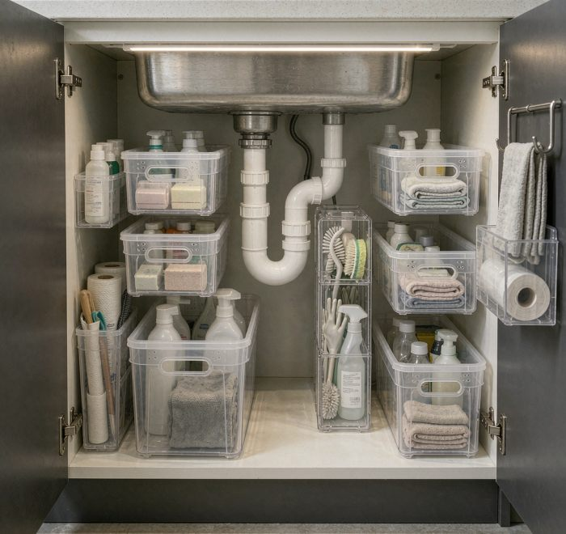

My closet is 4 feet wide, 5 deep, 7 tall. For the first year I used it the standard way: one rod, a shelf above, shoes wherever they landed. Getting dressed took ten to fifteen minutes, and I bought duplicates because I couldn't see what I owned.

The fix wasn't a bigger closet. I went vertical and built three zones out of that one rod. The same rod-to-shelf measurement shows up as one of the eleven numbers in the [whole-home organization system](/blog/whole-home-organization-system/), where this room is one chapter of a twelve-week plan.

Eye level holds the rod I touch every day, mounted at about 60 inches, roughly 40 items sorted by type. Nineteen inches above it, a second rod at 79 inches takes the clothes I wear less. Seasonal pieces, occasional formalwear, work-from-home things. The heaviest seasonal gear that won't fit up there spends summer in storage instead, handled with a proper wash-and-pack routine ([how to store winter clothes the right way](/blog/how-to-store-winter-clothes-in-summer/)).

Below, a shoe rack, a three-drawer unit for socks and accessories (the belts live there too, [rolled the leather-safe way](/blog/how-to-store-belts-in-closet/)), and shelves for folded clothes. Each spot has one job. The pairs worth showing rather than wearing moved off the rack into [clear stackable shoe boxes](/blog/clear-plastic-shoe-boxes-stackable-design/) beside the dresser. Same visibility rule, dust-proof execution.

Two habits keep it working. The first is folding. I file sweaters and jeans upright instead of stacking, so every edge shows and nothing gets buried. That matters more than it sounds: a cashmere sweater once sat in a stack with its tag on for months, forgotten. The fold is nothing fancy. Lay flat, fold in half lengthwise, fold again to about 6 inches wide, once more, stand it up. Pants go in thirds. Open the drawer and you see every item at once. For the stacks that do live on a shelf, [shelf dividers keep them standing](/blog/closet-shelf-dividers-for-folded-sweaters/) instead of leaning.

The second habit is rotation. Every two weeks I swap the main rod, pulling what I haven't worn and bringing in pieces from the second rod and shelves. Clothes I'd forgotten feel new again. Anything that sits through several rotations is telling me something, and that's how the donation pile forms without a painful audit.

## What I got wrong first

The version that lasted was the third try. The first double rod I hung at 68 inches, and every dress and long coat dragged the floor, so I stopped using the bottom rod entirely. The second attempt used fabric bins without rigid inserts, and a folded sweater slid into the gap behind them and stayed lost for a season. The hangers were the quiet win: I started with tube plastic hangers about half an inch thick, and 40 of them ate three inches more rod than the slim velvet ones at a fifth of an inch. Switching hangers freed a third of the rod for nothing but money. None of that shows in the final photo, and all of it is why the final photo works.

The whole setup cost $93 to $197 over a few months: a second rod and brackets, wooden dividers, the drawer unit, shelving, velvet hangers. It also killed my $50-a-month storage rental, so it paid for itself in a season. I fit 200-plus items now and still leave some space empty on purpose. A closet with air in it is easier to keep tidy than a packed one.

Six months in, the measurable part: dressing went from 12 to 15 minutes to about 90 seconds, and seasonal swaps went from a renovation day to half an hour. The quieter result matters more. I stopped buying things I already own.

If you're starting from a single-rod closet, measure first, empty it and sort hard, add the second rod if you have the height, learn the vertical fold, and set a 14-day rotation reminder. Then adjust from what you actually wear, not what you wish you wore.
